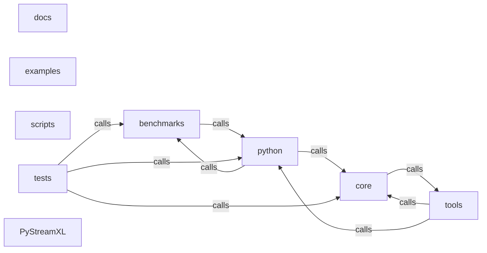

_Generated by CodeAtlas._

## Details

Architecture map of PyStreamXL.

### benchmarks

Owns 8 symbols across 3 file(s).

**Related Classes/Methods:** _None_

**Source Files:**

- `benchmarks/openpyxl_vs_pystreamxl.py`
  - `benchmarks.openpyxl_vs_pystreamxl.bench_openpyxl`
  - `benchmarks.openpyxl_vs_pystreamxl.bench_streamxl`
- `benchmarks/openpyxl_vs_pystreamxl_write.py`
  - `benchmarks.openpyxl_vs_pystreamxl_write.bench_openpyxl_write`
  - `benchmarks.openpyxl_vs_pystreamxl_write.bench_streamxl_write`
  - `benchmarks.openpyxl_vs_pystreamxl_write.file_mb`
  - `benchmarks.openpyxl_vs_pystreamxl_write.fmt`
  - `benchmarks.openpyxl_vs_pystreamxl_write.make_rows`
  - `benchmarks.openpyxl_vs_pystreamxl_write.run`

### core

Owns 0 symbols across 1 file(s).

**Related Classes/Methods:** _None_

### docs

Owns 0 symbols across 2 file(s).

**Related Classes/Methods:** _None_

### examples

Owns 0 symbols across 3 file(s).

**Related Classes/Methods:** _None_

### python

Owns 0 symbols across 1 file(s).

**Related Classes/Methods:** _None_

### scripts

Owns 0 symbols across 5 file(s).

**Related Classes/Methods:** _None_

### tests

Owns 208 symbols across 18 file(s).

**Related Classes/Methods:** _None_

**Source Files:**

- `tests/conftest.py`
  - `tests.conftest.empty_xlsx`
  - `tests.conftest.tmp_large_xlsx`
  - `tests.conftest.tmp_xlsx`
- `tests/test_analyzers.py`
  - `tests.test_analyzers.test_analyzers_are_importable_from_package_root`
  - `tests.test_analyzers.test_collaboration_detector_surface`
  - `tests.test_analyzers.test_cross_sheet_dependency_and_critical_paths`
  - `tests.test_analyzers.test_cross_sheet_redundancy_detection`
  - `tests.test_analyzers.test_incremental_recalculation_propagates`
- `tests/test_basic.py`
  - `tests.test_basic.test_empty_file_returns_empty`
  - `tests.test_basic.test_read_returns_rows`
  - `tests.test_basic.test_row_is_list`
- `tests/test_codeatlas_adapter.py`
  - `tests.test_codeatlas_adapter._run`
  - `tests.test_codeatlas_adapter.test_check_reports_the_embedded_engine_available`
  - `tests.test_codeatlas_adapter.test_diagnose_summarises_the_architecture_map`
  - `tests.test_codeatlas_adapter.test_explain_reports_an_unknown_node_as_an_error`
  - `tests.test_codeatlas_adapter.test_god_nodes_are_ranked_by_degree`
- `tests/test_comments.py`
  - `tests.test_comments.test_comment_author_preserved`
  - `tests.test_comments.test_comments_with_as_dict`
  - `tests.test_comments.test_comments_with_column_filtering`
  - `tests.test_comments.test_no_comment_cells`
  - `tests.test_comments.test_read_comments_structure`
  - `tests.test_comments.test_read_with_comments_no_formulas`
  - `tests.test_comments.workbook_with_comments`
- `tests/test_conditional_formatting.py`
  - `tests.test_conditional_formatting.test_all_rules_captured`
  - `tests.test_conditional_formatting.test_between_rule_has_two_formulas`
  - `tests.test_conditional_formatting.test_cell_is_rule_resolves_dxf`
  - `tests.test_conditional_formatting.test_conditional_formats_raises_on_missing_file`
  - `tests.test_conditional_formatting.test_conditional_formats_respects_sheet_argument`
  - `tests.test_conditional_formatting.test_no_conditional_formatting_returns_empty_list`
  - `tests.test_conditional_formatting.test_rule_without_dxf_id_has_none_format`
  - `tests.test_conditional_formatting.workbook_with_conditional_formatting`
- `tests/test_dates.py`
  - `tests.test_dates.roundtrip`
  - `tests.test_dates.test_date_epoch_boundary`
  - `tests.test_dates.test_date_mixed_with_other_types`
  - `tests.test_dates.test_date_modern`
  - `tests.test_dates.test_date_roundtrip`
  - `tests.test_dates.test_date_type_preserved`
  - `tests.test_dates.test_datetime_end_of_day`
  - `tests.test_dates.test_datetime_midnight`
  - `tests.test_dates.test_datetime_roundtrip`
  - `tests.test_dates.test_multiple_dates_in_row`
  - `tests.test_dates.test_writer_with_dates`
- `tests/test_error_recovery.py`
  - `tests.test_error_recovery.TestCellError`
  - `tests.test_error_recovery.TestCellError.test_cell_error_creation`
  - `tests.test_error_recovery.TestCellError.test_cell_error_formatting`
  - `tests.test_error_recovery.TestCellError.test_cell_error_with_location`
  - `tests.test_error_recovery.TestCellError.test_cell_error_with_suggestion`
  - `tests.test_error_recovery.TestErrorCategory`
  - `tests.test_error_recovery.TestErrorCategory.test_category_values`
  - `tests.test_error_recovery.TestErrorRecoveryHandler`
  - `tests.test_error_recovery.TestErrorRecoveryHandler.test_handler_fail_fast`
  - `tests.test_error_recovery.TestErrorRecoveryHandler.test_handler_max_errors`
  - `tests.test_error_recovery.TestErrorRecoveryHandler.test_handler_recovery_suggestions`
  - `tests.test_error_recovery.TestErrorRecoveryHandler.test_handler_should_skip_cell`
  - `tests.test_error_recovery.TestErrorRecoveryHandler.test_handler_skip_non_fatal`
  - `tests.test_error_recovery.TestErrorRecoveryHandler.test_handler_with_report`
  - `tests.test_error_recovery.TestErrorSeverity`
  - `tests.test_error_recovery.TestErrorSeverity.test_severity_values`
  - `tests.test_error_recovery.TestValidationReport`
  - `tests.test_error_recovery.TestValidationReport.test_report_add_error`
  - `tests.test_error_recovery.TestValidationReport.test_report_add_warning`
  - `tests.test_error_recovery.TestValidationReport.test_report_creation`
  - `tests.test_error_recovery.TestValidationReport.test_report_empty_error_percentage`
  - `tests.test_error_recovery.TestValidationReport.test_report_error_percentage`
  - `tests.test_error_recovery.TestValidationReport.test_report_errors_by_category`
  - `tests.test_error_recovery.TestValidationReport.test_report_summary_format`
  - `tests.test_error_recovery.TestValidationReport.test_report_to_dict`
- `tests/test_formula_tools.py`
  - `tests.test_formula_tools.TestFormulaReferenceMapper`
  - `tests.test_formula_tools.TestFormulaReferenceMapper.test_col_to_num_double_letter`
  - `tests.test_formula_tools.TestFormulaReferenceMapper.test_col_to_num_single_letter`
  - `tests.test_formula_tools.TestFormulaReferenceMapper.test_extract_absolute_references`
  - `tests.test_formula_tools.TestFormulaReferenceMapper.test_extract_multiple_references`
  - `tests.test_formula_tools.TestFormulaReferenceMapper.test_extract_range_references`
  - `tests.test_formula_tools.TestFormulaReferenceMapper.test_extract_ranges_absolute`
  - `tests.test_formula_tools.TestFormulaReferenceMapper.test_extract_ranges_multiple`
  - `tests.test_formula_tools.TestFormulaReferenceMapper.test_extract_ranges_simple`
  - `tests.test_formula_tools.TestFormulaReferenceMapper.test_extract_single_reference`
  - `tests.test_formula_tools.TestFormulaReferenceMapper.test_get_affected_cells`
  - `tests.test_formula_tools.TestFormulaReferenceMapper.test_get_affected_cells_range`
  - `tests.test_formula_tools.TestFormulaReferenceMapper.test_map_cell_coordinates_multiple_cells`
  - `tests.test_formula_tools.TestFormulaReferenceMapper.test_map_cell_coordinates_negative_offset`
  - `tests.test_formula_tools.TestFormulaReferenceMapper.test_map_cell_coordinates_no_offset`
  - `tests.test_formula_tools.TestFormulaReferenceMapper.test_map_cell_coordinates_preserve_absolute_col`
  - `tests.test_formula_tools.TestFormulaReferenceMapper.test_map_cell_coordinates_preserve_absolute_row`
  - `tests.test_formula_tools.TestFormulaReferenceMapper.test_map_cell_coordinates_preserve_both_absolute`
  - `tests.test_formula_tools.TestFormulaReferenceMapper.test_map_cell_coordinates_simple`
  - `tests.test_formula_tools.TestFormulaReferenceMapper.test_num_to_col_double_digit`
  - `tests.test_formula_tools.TestFormulaReferenceMapper.test_num_to_col_single_digit`
  - `tests.test_formula_tools.TestFormulaReferenceMapper.test_substitute_reference_case_insensitive`
  - `tests.test_formula_tools.TestFormulaReferenceMapper.test_substitute_reference_preserves_others`
  - `tests.test_formula_tools.TestFormulaReferenceMapper.test_substitute_reference_simple`
  - `tests.test_formula_tools.TestFormulaSerializer`
  - `tests.test_formula_tools.TestFormulaSerializer.sample_rows_with_metadata`
  - `tests.test_formula_tools.TestFormulaSerializer.test_export_formulas`
  - `tests.test_formula_tools.TestFormulaSerializer.test_export_formulas_structure`
  - `tests.test_formula_tools.TestFormulaSerializer.test_export_formulas_types`
  - `tests.test_formula_tools.TestFormulaSerializer.test_export_to_csv`
  - `tests.test_formula_tools.TestFormulaSerializer.test_export_to_csv_neutralizes_formula_injection`
  - `tests.test_formula_tools.TestFormulaSerializer.test_export_to_json`
  - `tests.test_formula_tools.TestFormulaSerializer.test_get_formula_stats`
  - `tests.test_formula_tools.TestFormulaSerializer.test_get_formula_stats_counts`
  - `tests.test_formula_tools.TestFormulaSerializer.test_import_formulas`
  - `tests.test_formula_tools.TestFormulaSerializer.test_roundtrip_export_import`
  - `tests.test_formula_tools.TestFormulaSerializer.test_sanitize_csv_cell_directly`
  - `tests.test_formula_tools.TestFormulaSerializer.test_validate_export_format_missing_sheets`
  - `tests.test_formula_tools.TestFormulaSerializer.test_validate_export_format_missing_version`
  - `tests.test_formula_tools.TestFormulaSerializer.test_validate_export_format_valid`
- `tests/test_formulas.py`
  - `tests.test_formulas.formula_workbook`
  - `tests.test_formulas.test_empty_cells_with_formulas`
  - `tests.test_formulas.test_formula_type_detection`
  - `tests.test_formulas.test_formula_value_preservation`
  - `tests.test_formulas.test_metadata_dict_structure`
  - `tests.test_formulas.test_read_with_columns_and_formulas`
  - `tests.test_formulas.test_read_with_dict_and_formulas`
  - `tests.test_formulas.test_read_with_formulas`
  - `tests.test_formulas.test_read_without_formulas`
- `tests/test_multisheet.py`
  - `tests.test_multisheet.test_as_dict_basic`
  - `tests.test_multisheet.test_as_dict_empty_data`
  - `tests.test_multisheet.test_as_dict_header_not_in_result`
  - `tests.test_multisheet.test_columns_by_index`
  - `tests.test_multisheet.test_columns_by_name_with_as_dict`
  - `tests.test_multisheet.test_columns_by_name_without_as_dict`
  - `tests.test_multisheet.test_multisheet_each_sheet_independent`
  - `tests.test_multisheet.test_multisheet_preserves_data_types`
  - `tests.test_multisheet.test_multisheet_read_by_name`
  - `tests.test_multisheet.test_multisheet_shared_strings_across_sheets`
  - `tests.test_multisheet.test_multisheet_write_read_first`
  - `tests.test_multisheet.test_read_invalid_sheet_raises`
  - `tests.test_multisheet.test_sheets_multi`
  - `tests.test_multisheet.test_sheets_single`
- `tests/test_new_features.py`
  - `tests.test_new_features.test_append_basic`
  - `tests.test_new_features.test_append_file_unchanged_on_error`
  - `tests.test_new_features.test_append_invalid_sheet_raises`
  - `tests.test_new_features.test_append_preserves_other_sheets`
  - `tests.test_new_features.test_append_to_named_sheet`
  - `tests.test_new_features.test_append_with_dates`
  - `tests.test_new_features.test_bold_default_is_false`
  - `tests.test_new_features.test_bold_multi_sheet`
  - `tests.test_new_features.test_bold_row_roundtrip`
  - `tests.test_new_features.test_bold_with_all_types`
  - `tests.test_new_features.test_read_all_as_dict`
  - `tests.test_new_features.test_read_all_empty_file`
  - `tests.test_new_features.test_read_all_multi_sheet`
  - `tests.test_new_features.test_read_all_single_sheet`
- `tests/test_security.py`
  - `tests.test_security.test_deep_traversal_to_absolute_path_is_rejected`
  - `tests.test_security.test_legitimate_nested_path_inside_base_dir_is_accepted`
  - `tests.test_security.test_legitimate_path_inside_base_dir_is_accepted`
  - `tests.test_security.test_legitimate_read_and_write_inside_base_dir`
  - `tests.test_security.test_no_base_dir_preserves_prior_behavior`
  - `tests.test_security.test_traversal_outside_base_dir_is_rejected`
  - `tests.test_security.test_traversal_via_read_path_is_rejected`
  - `tests.test_security.test_traversal_via_write_path_is_rejected`
- `tests/test_server.py`
  - `tests.test_server.TestFlaskApiKeyAuth`
  - `tests.test_server.TestFlaskApiKeyAuth._require_flask`
  - `tests.test_server.TestFlaskApiKeyAuth.test_matching_key_is_accepted`
  - `tests.test_server.TestFlaskApiKeyAuth.test_missing_or_wrong_key_is_rejected`
  - `tests.test_server.TestFlaskApiKeyAuth.test_unset_key_warns_but_leaves_server_open`
  - `tests.test_server.TestFlaskAppReal`
  - `tests.test_server.TestFlaskAppReal._require_flask`
  - `tests.test_server.TestFlaskAppReal.client`
  - `tests.test_server.TestFlaskAppReal.test_connect_source_missing_path_returns_400`
  - `tests.test_server.TestFlaskAppReal.test_full_workflow_connect_query_export`
  - `tests.test_server.TestFlaskAppReal.test_health_endpoint`
  - `tests.test_server.TestFlaskAppReal.test_query_unknown_source_returns_400`
  - `tests.test_server.TestPyStreamXLServerReal`
  - `tests.test_server.TestPyStreamXLServerReal.test_connect_source_missing_path_is_error`
  - `tests.test_server.TestPyStreamXLServerReal.test_connect_source_nonexistent_file_is_error`
  - `tests.test_server.TestPyStreamXLServerReal.test_connect_source_reads_real_sheets`
  - `tests.test_server.TestPyStreamXLServerReal.test_execute_query_respects_limit_on_real_data`
  - `tests.test_server.TestPyStreamXLServerReal.test_execute_query_returns_real_rows`
  - `tests.test_server.TestPyStreamXLServerReal.test_execute_query_unknown_sheet_falls_back_to_first_real_sheet`
  - `tests.test_server.TestPyStreamXLServerReal.test_execute_query_unknown_source_is_error`
  - `tests.test_server.TestPyStreamXLServerReal.test_export_data_csv_matches_real_content_and_is_sanitized`
  - `tests.test_server.TestPyStreamXLServerReal.test_export_data_json_matches_real_content`
  - `tests.test_server.TestPyStreamXLServerReal.test_export_data_unknown_sheet_is_error`
  - `tests.test_server.TestPyStreamXLServerReal.test_health_check_reports_real_counts_and_version`
  - `tests.test_server.TestPyStreamXLServerReal.test_list_sheets_matches_real_file`
  - `tests.test_server.TestPyStreamXLServerReal.test_list_sources_does_not_leak_filesystem_paths`
  - `tests.test_server.TestStreamXLServerDeprecatedAlias`
  - `tests.test_server.TestStreamXLServerDeprecatedAlias.test_old_name_still_works_but_warns`
  - `tests.test_server.two_sheet_xlsx`
- `tests/test_shared_strings.py`
  - `tests.test_shared_strings.test_empty_sst`
  - `tests.test_shared_strings.test_shared_strings_roundtrip`
- `tests/test_streaming.py`
  - `tests.test_streaming.test_is_iterator`
  - `tests.test_streaming.test_memory_constant`
  - `tests.test_streaming.test_read_actually_streams_not_eager_then_yield`
  - `tests.test_streaming.test_streaming_and_eager_apis_return_identical_data`
  - `tests.test_streaming.test_streaming_propagates_errors_like_the_eager_path`
  - `tests.test_streaming.test_streaming_reader_is_one_shot_like_a_real_iterator`
  - `tests.test_streaming.test_streaming_with_formulas_matches_eager`
- `tests/test_version_consistency.py`
  - `tests.test_version_consistency.test_cli_version_matches_package_version`
  - `tests.test_version_consistency.test_version_matches_pyproject_toml`
- `tests/test_write.py`
  - `tests.test_write.roundtrip`
  - `tests.test_write.test_context_manager_close_is_idempotent`
  - `tests.test_write.test_context_manager_creates_file`
  - `tests.test_write.test_context_manager_roundtrip`
  - `tests.test_write.test_write_creates_file`
  - `tests.test_write.test_write_empty_rows`
  - `tests.test_write.test_write_integers_become_floats`
  - `tests.test_write.test_write_large_roundtrip`
  - `tests.test_write.test_write_roundtrip_booleans`
  - `tests.test_write.test_write_roundtrip_none`
  - `tests.test_write.test_write_roundtrip_numbers`
  - `tests.test_write.test_write_roundtrip_row_count`
  - `tests.test_write.test_write_roundtrip_strings`
  - `tests.test_write.test_write_single_row`
  - `tests.test_write.test_write_special_chars`
  - `tests.test_write.test_writer_error_after_close`

### tools

Owns 0 symbols across 0 file(s).

**Related Classes/Methods:** _None_

### PyStreamXL

Owns 0 symbols across 17 file(s).

**Related Classes/Methods:** _None_
