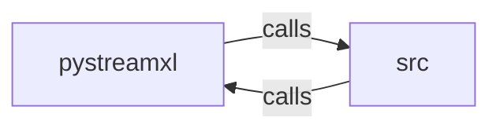

_Generated by CodeAtlas._

## Details

Owns 0 symbols across 1 file(s).

### pystreamxl

Owns 142 symbols across 14 file(s).

**Related Classes/Methods:** _None_

**Source Files:**

- `python/pystreamxl/_formula_support.py`
  - `python.pystreamxl._formula_support.FormulaAnalyzer`
  - `python.pystreamxl._formula_support.FormulaAnalyzer.extract_ranges`
  - `python.pystreamxl._formula_support.FormulaAnalyzer.extract_references`
  - `python.pystreamxl._formula_support.FormulaAnalyzer.get_formula_type`
  - `python.pystreamxl._formula_support.FormulaAnalyzer.is_circular_reference`
  - `python.pystreamxl._formula_support.FormulaAnalyzer.is_formula`
  - `python.pystreamxl._formula_support.FormulaCell`
  - `python.pystreamxl._formula_support.FormulaMapping`
  - `python.pystreamxl._formula_support.FormulaPreserver`
  - `python.pystreamxl._formula_support.FormulaPreserver.__init__`
  - `python.pystreamxl._formula_support.FormulaPreserver._col_to_num`
  - `python.pystreamxl._formula_support.FormulaPreserver._index_to_cell_ref`
  - `python.pystreamxl._formula_support.FormulaPreserver._num_to_col`
  - `python.pystreamxl._formula_support.FormulaPreserver._shift_references`
  - `python.pystreamxl._formula_support.FormulaPreserver._shift_references.shift_cell_ref`
  - `python.pystreamxl._formula_support.FormulaPreserver.add_formula`
  - `python.pystreamxl._formula_support.FormulaPreserver.export_formulas`
  - `python.pystreamxl._formula_support.FormulaPreserver.get_formula`
  - `python.pystreamxl._formula_support.FormulaPreserver.import_formulas`
  - `python.pystreamxl._formula_support.FormulaPreserver.update_references`
  - `python.pystreamxl._formula_support.FormulaPreserver.validate_formulas`
  - `python.pystreamxl._formula_support.FormulaSubstitution`
  - `python.pystreamxl._formula_support.FormulaSubstitution.substitute`
  - `python.pystreamxl._formula_support.FormulaSubstitution.substitute_range`
  - `python.pystreamxl._formula_support.FormulaType`
- `python/pystreamxl/api.py`
  - `python.pystreamxl.api.append`
  - `python.pystreamxl.api.conditional_formats`
  - `python.pystreamxl.api.read`
  - `python.pystreamxl.api.read_all`
  - `python.pystreamxl.api.sheets`
  - `python.pystreamxl.api.stream`
  - `python.pystreamxl.api.write`
  - `python.pystreamxl.api.writer`
- `python/pystreamxl/cli.py`
  - `python.pystreamxl.cli.dashboard_command`
  - `python.pystreamxl.cli.main`
- `python/pystreamxl/cli_dashboard.py`
  - `python.pystreamxl.cli_dashboard.DashboardMetrics`
  - `python.pystreamxl.cli_dashboard.PyStreamXLDashboard`
  - `python.pystreamxl.cli_dashboard.PyStreamXLDashboard.__init__`
  - `python.pystreamxl.cli_dashboard.PyStreamXLDashboard.export_json`
  - `python.pystreamxl.cli_dashboard.PyStreamXLDashboard.get_mock_metrics`
  - `python.pystreamxl.cli_dashboard.PyStreamXLDashboard.run_dashboard`
  - `python.pystreamxl.cli_dashboard.PyStreamXLDashboard.show_alerts`
  - `python.pystreamxl.cli_dashboard.PyStreamXLDashboard.show_recommendations`
  - `python.pystreamxl.cli_dashboard.RichDashboard`
  - `python.pystreamxl.cli_dashboard.RichDashboard.__init__`
  - `python.pystreamxl.cli_dashboard.RichDashboard.render`
  - `python.pystreamxl.cli_dashboard.SimpleDashboard`
  - `python.pystreamxl.cli_dashboard.SimpleDashboard.__init__`
  - `python.pystreamxl.cli_dashboard.SimpleDashboard.render`
  - `python.pystreamxl.cli_dashboard.TextualDashboard`
  - `python.pystreamxl.cli_dashboard.TextualDashboard.__init__`
  - `python.pystreamxl.cli_dashboard.TextualDashboard.render`
  - `python.pystreamxl.cli_dashboard.get_dashboard_impl`
- `python/pystreamxl/core.py`
  - `python.pystreamxl.core.get_conditional_formats`
  - `python.pystreamxl.core.list_sheets`
  - `python.pystreamxl.core.read_rows`
  - `python.pystreamxl.core.read_rows_all_at_once`
  - `python.pystreamxl.core.read_rows_with_metadata`
  - `python.pystreamxl.core.read_rows_with_metadata_all_at_once`
  - `python.pystreamxl.core.write_rows`
- `python/pystreamxl/error_messages.py`
  - `python.pystreamxl.error_messages.ExcelError`
  - `python.pystreamxl.error_messages.ExcelError.__init__`
  - `python.pystreamxl.error_messages.ExcelError.__str__`
  - `python.pystreamxl.error_messages.ExcelError.format`
  - `python.pystreamxl.error_messages.get_sheet_error`
  - `python.pystreamxl.error_messages.get_size_error`
- `python/pystreamxl/error_recovery.py`
  - `python.pystreamxl.error_recovery.CellError`
  - `python.pystreamxl.error_recovery.CellError.format_detailed`
  - `python.pystreamxl.error_recovery.ErrorCategory`
  - `python.pystreamxl.error_recovery.ErrorRecoveryHandler`
  - `python.pystreamxl.error_recovery.ErrorRecoveryHandler.__init__`
  - `python.pystreamxl.error_recovery.ErrorRecoveryHandler.add_error`
  - `python.pystreamxl.error_recovery.ErrorRecoveryHandler.get_recovery_suggestions`
  - `python.pystreamxl.error_recovery.ErrorRecoveryHandler.should_skip_cell`
  - `python.pystreamxl.error_recovery.ErrorSeverity`
  - `python.pystreamxl.error_recovery.ExcelValidationError`
  - `python.pystreamxl.error_recovery.ExcelValidationError.__init__`
  - `python.pystreamxl.error_recovery.RecoveryMode`
  - `python.pystreamxl.error_recovery.ValidationReport`
  - `python.pystreamxl.error_recovery.ValidationReport.add_error`
  - `python.pystreamxl.error_recovery.ValidationReport.error_count`
  - `python.pystreamxl.error_recovery.ValidationReport.error_percentage`
  - `python.pystreamxl.error_recovery.ValidationReport.errors_by_category`
  - `python.pystreamxl.error_recovery.ValidationReport.format_detailed`
  - `python.pystreamxl.error_recovery.ValidationReport.format_summary`
  - `python.pystreamxl.error_recovery.ValidationReport.has_fatal_errors`
  - `python.pystreamxl.error_recovery.ValidationReport.has_recoverable_errors`
  - `python.pystreamxl.error_recovery.ValidationReport.to_dict`
  - `python.pystreamxl.error_recovery.ValidationReport.warning_count`
  - `python.pystreamxl.error_recovery._num_to_col`
  - `python.pystreamxl.error_recovery.validate_excel_file`
- `python/pystreamxl/formula_io.py`
  - `python.pystreamxl.formula_io.FormulaSerializer`
  - `python.pystreamxl.formula_io.FormulaSerializer.export_formulas`
  - `python.pystreamxl.formula_io.FormulaSerializer.export_to_csv`
  - `python.pystreamxl.formula_io.FormulaSerializer.export_to_json`
  - `python.pystreamxl.formula_io.FormulaSerializer.get_formula_stats`
  - `python.pystreamxl.formula_io.FormulaSerializer.import_formulas`
  - `python.pystreamxl.formula_io.FormulaSerializer.validate_export_format`
- `python/pystreamxl/formula_reference_mapper.py`
  - `python.pystreamxl.formula_reference_mapper.FormulaReferenceMapper`
  - `python.pystreamxl.formula_reference_mapper.FormulaReferenceMapper._col_to_num`
  - `python.pystreamxl.formula_reference_mapper.FormulaReferenceMapper._num_to_col`
  - `python.pystreamxl.formula_reference_mapper.FormulaReferenceMapper._parse_col_row`
  - `python.pystreamxl.formula_reference_mapper.FormulaReferenceMapper._shift_single_ref`
  - `python.pystreamxl.formula_reference_mapper.FormulaReferenceMapper.extract_cell_refs`
  - `python.pystreamxl.formula_reference_mapper.FormulaReferenceMapper.extract_ranges`
  - `python.pystreamxl.formula_reference_mapper.FormulaReferenceMapper.get_affected_cells`
  - `python.pystreamxl.formula_reference_mapper.FormulaReferenceMapper.map_cell_coordinates`
  - `python.pystreamxl.formula_reference_mapper.FormulaReferenceMapper.map_cell_coordinates.shift_cell_ref`
  - `python.pystreamxl.formula_reference_mapper.FormulaReferenceMapper.substitute_reference`
- `python/pystreamxl/integrity.py`
  - `python.pystreamxl.integrity.AtomicFileWriter`
  - `python.pystreamxl.integrity.AtomicFileWriter.__enter__`
  - `python.pystreamxl.integrity.AtomicFileWriter.__exit__`
  - `python.pystreamxl.integrity.AtomicFileWriter.__init__`
  - `python.pystreamxl.integrity.atomic_write`
  - `python.pystreamxl.integrity.calculate_file_hash`
  - `python.pystreamxl.integrity.safe_file_write`
  - `python.pystreamxl.integrity.verify_file_integrity`
- `python/pystreamxl/security.py`
  - `python.pystreamxl.security.SecurityError`
  - `python.pystreamxl.security.get_security_limits`
  - `python.pystreamxl.security.sanitize_csv_cell`
  - `python.pystreamxl.security.validate_read_path`
  - `python.pystreamxl.security.validate_write_path`
  - `python.pystreamxl.security.validate_xlsx_path`
- `python/pystreamxl/server.py`
  - `python.pystreamxl.server.PyStreamXLServer`
  - `python.pystreamxl.server.PyStreamXLServer.__init__`
  - `python.pystreamxl.server.PyStreamXLServer.connect_source`
  - `python.pystreamxl.server.PyStreamXLServer.execute_query`
  - `python.pystreamxl.server.PyStreamXLServer.export_data`
  - `python.pystreamxl.server.PyStreamXLServer.health_check`
  - `python.pystreamxl.server.PyStreamXLServer.list_sheets`
  - `python.pystreamxl.server.PyStreamXLServer.list_sources`
  - `python.pystreamxl.server.StreamXLServer`
  - `python.pystreamxl.server.StreamXLServer.__init__`
  - `python.pystreamxl.server.create_flask_app`
  - `python.pystreamxl.server.create_flask_app._require_api_key`
  - `python.pystreamxl.server.create_flask_app.connect_source`
  - `python.pystreamxl.server.create_flask_app.export`
  - `python.pystreamxl.server.create_flask_app.health`
  - `python.pystreamxl.server.create_flask_app.list_sources`
  - `python.pystreamxl.server.create_flask_app.query`
  - `python.pystreamxl.server.create_flask_app.sheets`
  - `python.pystreamxl.server.run_server`

### src

Owns 25 symbols across 1 file(s).

**Related Classes/Methods:** _None_

**Source Files:**

- `python/src/lib.rs`
  - `python.src.lib.PyRowIter`
  - `python.src.lib.PyRowIter.__iter__`
  - `python.src.lib.PyRowIter.__next__`
  - `python.src.lib.PyRowIterMetadata`
  - `python.src.lib.PyRowIterMetadata.__iter__`
  - `python.src.lib.PyRowIterMetadata.__next__`
  - `python.src.lib.PyXlsxWriter`
  - `python.src.lib.PyXlsxWriter.__enter__`
  - `python.src.lib.PyXlsxWriter.__exit__`
  - `python.src.lib.PyXlsxWriter.add_sheet`
  - `python.src.lib.PyXlsxWriter.close`
  - `python.src.lib.PyXlsxWriter.new`
  - `python.src.lib.PyXlsxWriter.write_row`
  - `python.src.lib._core`
  - `python.src.lib.cell_to_pyobject`
  - `python.src.lib.conditional_formats`
  - `python.src.lib.dxf_to_pydict`
  - `python.src.lib.metadata_to_pydict`
  - `python.src.lib.pyobject_to_writecell`
  - `python.src.lib.read`
  - `python.src.lib.read_with_metadata`
  - `python.src.lib.sheets`
  - `python.src.lib.stream_rows`
  - `python.src.lib.stream_rows_with_metadata`
  - `python.src.lib.write`
