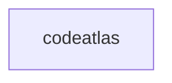

_Generated by CodeAtlas._

## Details

Owns 0 symbols across 0 file(s).

### codeatlas

Owns 22 symbols across 2 file(s).

**Related Classes/Methods:** _None_

**Source Files:**

- `tools/codeatlas/codeatlas_adapter.py`
  - `tools.codeatlas.codeatlas_adapter._build_graph`
  - `tools.codeatlas.codeatlas_adapter._build_graph.collect`
  - `tools.codeatlas.codeatlas_adapter._component_symbols`
  - `tools.codeatlas.codeatlas_adapter._degree`
  - `tools.codeatlas.codeatlas_adapter._edge`
  - `tools.codeatlas.codeatlas_adapter._emit`
  - `tools.codeatlas.codeatlas_adapter._iter_components`
  - `tools.codeatlas.codeatlas_adapter._load_engine`
  - `tools.codeatlas.codeatlas_adapter._resolve`
  - `tools.codeatlas.codeatlas_adapter._run_analysis`
  - `tools.codeatlas.codeatlas_adapter._unavailable`
  - `tools.codeatlas.codeatlas_adapter.build_parser`
  - `tools.codeatlas.codeatlas_adapter.build_parser.common`
  - `tools.codeatlas.codeatlas_adapter.cmd_affected`
  - `tools.codeatlas.codeatlas_adapter.cmd_build`
  - `tools.codeatlas.codeatlas_adapter.cmd_check`
  - `tools.codeatlas.codeatlas_adapter.cmd_diagnose`
  - `tools.codeatlas.codeatlas_adapter.cmd_explain`
  - `tools.codeatlas.codeatlas_adapter.cmd_god_nodes`
  - `tools.codeatlas.codeatlas_adapter.cmd_path`
  - `tools.codeatlas.codeatlas_adapter.cmd_query`
  - `tools.codeatlas.codeatlas_adapter.main`
